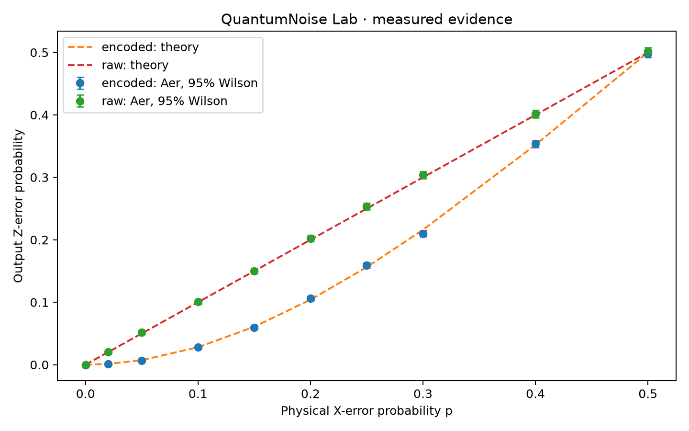
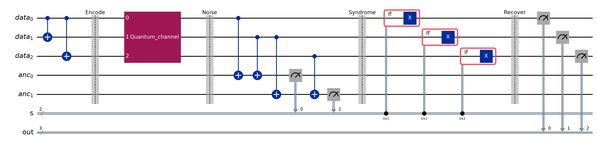

# QuantumNoise Lab
### When Does Quantum Error Correction Actually Help?

An interactive, reproducible Qiskit experiment investigating the three-qubit X-error repetition code under independent errors, fixed-marginal pair-correlated errors, and faulty syndrome reports. Created on November 8, 2026 for Qiskit Fall Fest at Virginia Tech's Advanced Track.

The quantum circuit is the experiment: Qiskit Aer executes encoding, a joint Pauli noise channel, two parity measurements, classical-condition X recovery, and final data measurements. The UI does not substitute classical random draws for quantum simulation. No real IBM Quantum hardware was used.



## Main result

At physical error probability **p = 0.10**, the actual 24,576-shot estimates are:

- Unencoded: **10.107%** output errors.
- Ideal repetition code, independent X noise: **2.812%**, versus the analytical prediction **2.800%**.
- Fixed-marginal pair-mixture noise, c = 1: **14.945%**, versus the analytical prediction **15.000%**.

The same physical marginal error rate can therefore produce either protection or harm, depending on the joint error structure. These are finite-shot simulator results, not a hardware advantage claim. See [measured findings](docs/FINDINGS.md) for confidence intervals and model-specific break-even analysis.

## Install and run

Python 3.12 was tested. From this directory:

```bash
python3.12 -m venv .venv
source .venv/bin/activate
python -m pip install -r requirements.txt
python -m streamlit run app/main.py
```

Open http://localhost:8501. The included evidence bundle makes the overview immediately usable. The Interactive Noise Lab runs fresh Aer jobs when submitted; a repeated configuration is explicitly labeled `CACHE HIT`. Choose “Force fresh Aer execution” to bypass that session cache. Editing controls alone does not execute a job.

The supplied local checkout already contains a ready-to-run `.venv`; `./run.sh` starts it. No IBM account, API key, or internet service is needed for experiments after installation.

## Reproduce all evidence

```bash
python -m experiments.run_all
python -m analysis.report
python -m pytest -q
python -m compileall -q quantum analysis experiments app tests
python -m ruff check quantum analysis experiments app tests
```

The full sweep executes 720 circuit runs and 5,898,240 shots, with 8,192 shots per circuit and seeds 2026, 1701, 31415. Runtime depends on the computer. Baselines use both |0⟩ and |1⟩; correlated and syndrome-cost sweeps use |0⟩. All ten requested p values are included. Pooled estimates use 24,576 shots per configuration and model. Raw counts, syndrome histograms, versions, timing and seeds are preserved.

`results/raw/experiments.csv` is the per-job evidence. `results/processed/summary.csv` sums counts within a configuration before calculating pointwise 95% Wilson intervals. `configuration.json` records the exact grids, versions and hashes of the raw and summary CSV files. `findings.json`, `benefit.csv` and `break_even.json` provide derived results. Plotly HTML exports embed their renderer and data, so they work offline.

Do not pool duplicated seed/configuration rows across experiment families as new independent evidence. For example, c=0 correlated runs intentionally repeat the independent reference. Timings and generation timestamps vary on reruns; fixed-seed counts should reproduce in the tested environment. Cross-version or cross-platform bitwise equality is not guaranteed.

## Circuit and observable

Encoding maps α|0⟩+β|1⟩ to α|000⟩+β|111⟩ using two CNOT gates; it does not clone an unknown state. Four more CNOTs extract s0=q0 XOR q1 and s1=q1 XOR q2 into two ancillas. Displayed strings use Qiskit's order **s1s0**:

- `00`: no recovery.
- `01`: X on q0.
- `11`: X on q1.
- `10`: X on q2.

A real Qiskit `if_test` block applies each recovery. Every single data X error is corrected. A two-bit error gives the same syndrome as the complementary single error, producing a logical X after recovery. Three errors have zero syndrome and also fail.

The reported logical observable is the recovered **q0 Z measurement**, equal to the first output of an ideal inverse encoder. For ideal syndrome extraction, recovered data is always a codeword and this equals the standard repetition-code logical error. With report noise, the recovered block may leave the codespace: output-q0 error and complete-codeword recovery success are separately recorded. This extension is an output-observable benchmark, not a full logical-channel fidelity characterization. Basis-state experiments do not establish arbitrary-state fidelity.



## Mathematical noise definitions

Let e be a three-bit X-error mask and |e| its Hamming weight. In the independent branch,

`P_iid(e) = p^|e| (1-p)^(3-|e|)`.

Our pair channel has `P_pair(000)=1−3p/2` and `P_pair(011)=P_pair(101)=P_pair(110)=p/2`, with all other probabilities zero. The complete channel is

`P(e) = (1−c) P_iid(e) + c P_pair(e)`.

Legal domain: `0≤p≤0.5`, `0≤c≤1`. Every physical marginal remains exactly p for every c. For p>0, the pairwise Pearson correlation is `c(1/2−p)/(1−p)`. It is undefined at zero variance (p=0); the UI displays zero by convention there. At p=0.5 the pairwise coefficient vanishes even though the joint distribution need not factorize. c measures mixture strength, not Pearson correlation.

This is a deliberately interpretable stochastic Pauli model, not a claim that all realistic correlated noise is pair noise. It demonstrates why single-qubit marginals alone cannot predict QEC performance. Aer applies the full three-qubit Pauli channel; the independent endpoint is exactly the tensor product of three bit-flip channels.

Analytical predictions with ideal correction:

`P_raw = p`

`P_L,iid = 3p² − 2p³`

`P_L,mixture = (1−c)(3p² − 2p³) + 3cp/2`

For 0<p<0.5, protection requires `c < (p−f)/(1.5p−f)`, where `f=3p²−2p³`. At p=0.10 this gives c<0.590164. This is an analytical boundary of this particular channel family.

## Syndrome-cost extension

Each syndrome bit is independently flipped with probability m immediately before ancilla measurement, equivalent to a classical report bit flip. Encoding, parity CNOTs, conditional recovery and final measurement are ideal. Only one additional source is introduced, so the cost is identifiable. Exact prediction enumerates eight data masks and four report-flip masks; it is independent of Aer sampling.

At p=0 the output error floor is m(1−m). At m=0.10, the theory predicts a low-p break-even near p=0.129190; the measured sweep changes benefit sign between p=0.10 and 0.15. These are model-specific crossings, **not universal fault-tolerance thresholds**. Confidence-aware benefit classifications are in `benefit.csv`; near crossings, sampling can leave the sign unresolved.

## Application

Five workspaces: Overview, Interactive Noise Lab, Quantum Circuit Explorer, Noise Comparison, Research Findings. Plotly provides hover, zoom, legend toggles and exports; displayed data can be downloaded. The circuit explorer uses `QuantumCircuit.draw()` and shows the actual mask probabilities for selected parameters. Scientific logic is separated from the Streamlit interface.

An application screenshot is saved at `docs/screenshots/overview.jpg`. Additional views are saved alongside it.

## Verification

Tests cover all eight injected error patterns and both inputs, syndrome ordering, correctable and uncorrectable patterns, probability normalization and marginals, valid parameters, theory agreement, seeded replay, CSV provenance, five Streamlit pages, and fresh execution/cache behavior. Statistical simulation checks use a conservative four-standard-error Wilson interval to avoid treating ordinary sampling fluctuations as a software failure. See `results/tests.log` for the executed test result.

## Scope, originality and provenance

This project was implemented from a new empty directory during the event. Standard repetition-code theory and official Qiskit API usage are cited below. Its contribution is the controlled fixed-marginal noise comparison, explicit noisy-report extension, auditable evidence pipeline, and integrated experiment interface; it does not claim to invent repetition codes or correlated-noise research. Development used Codex assistance. No other hackathon project was copied.

One round, three data qubits, two ancillas, stochastic X errors and computational-basis input/output. No phase-error protection, leakage, realistic device scheduling, coherent errors, hardware calibration, or fault-tolerant recovery. Clifford/Pauli circuits can be efficiently classically simulated; no quantum computational speedup is claimed. Statistical intervals are pointwise, not simultaneous over the sweep.

## Project layout

- `quantum/`: circuits, explicit noise distributions, syndrome map, Aer execution.
- `analysis/`: Wilson intervals, Plotly rendering, crossing and benefit analysis.
- `experiments/run_all.py`: full reproducible sweep and evidence generation.
- `app/main.py`: interactive Streamlit application.
- `tests/`: circuit, statistical, provenance and application tests.
- `results/`: real raw data, summaries, configuration and figures.
- `docs/`: findings, reproducibility, Devpost text and three-minute demo script.

## Submission

[Devpost submission text](docs/DEVPOST_SUBMISSION.md) · [English demo script](docs/DEMO_SCRIPT.md) · [Reproducibility notes](docs/REPRODUCIBILITY.md).

The official deadline was verified in the browser on November 8, 2026: **08:00 Eastern Standard Time / 21:00 Asia/Shanghai**. Devpost publication itself requires the participant's account and final submission.

## Dependencies and references

- [Qiskit Aer source and installation](https://github.com/Qiskit/qiskit-aer)
- [AerSimulator API](https://qiskit.github.io/qiskit-aer/stubs/qiskit_aer.AerSimulator.html)
- [Pauli error API](https://qiskit.github.io/qiskit-aer/stubs/qiskit_aer.noise.pauli_error.html)
- [Official noise-model tutorial](https://qiskit.github.io/qiskit-aer/tutorials/3_building_noise_models.html)
- [Qiskit QuantumCircuit API](https://quantum.cloud.ibm.com/docs/en/api/qiskit/qiskit.circuit.QuantumCircuit)
- [Official hackathon rules](https://qiskitatvt.devpost.com/rules)
- Wilson, E. B. (1927), “Probable inference, the law of succession, and statistical inference,” JASA 22(158), 209–212, doi:10.1080/01621459.1927.10502953.

Uses Qiskit, Qiskit Aer, NumPy, Pandas, SciPy, Plotly, Matplotlib, Streamlit, pytest and Ruff. Exact installed versions are pinned in `requirements.txt`. Original project code is MIT licensed; dependencies retain their respective licenses.

An optional GitHub Actions configuration is retained in `docs/ci/verify.yml`. It is not enabled: the existing publication credential lacks workflow scope. Local checks have completed; no remote CI success is claimed. See `docs/ci/README.md` to enable it later.

## Narrated demonstration

[Watch or download the 2:40 English demo](demo/output/QuantumNoise-Lab-demo.mp4). It includes burned-in English captions, actual application captures, the Qiskit circuit and figures derived from measured CSV data. The narration is synthesized with the macOS Daniel voice. This is an edited walkthrough with held frames, not an uncut continuous recording. See [video provenance and reproduction](demo/README.md).
